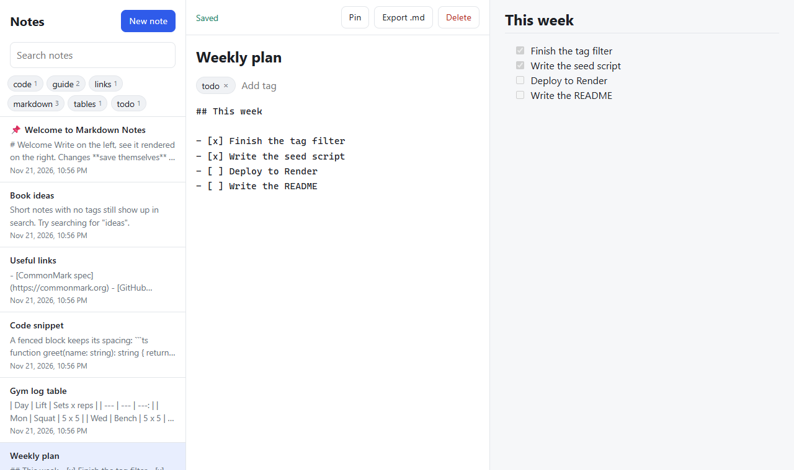
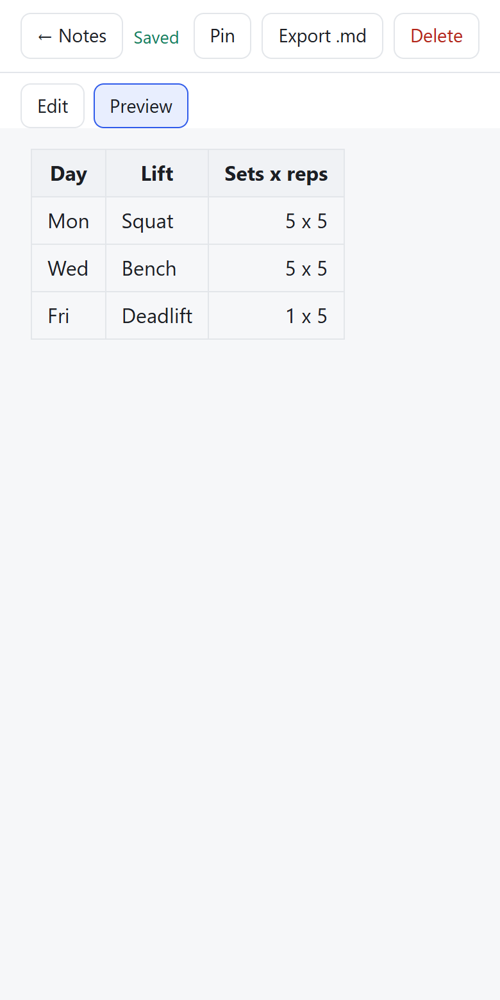

# Markdown Notes

Write notes in Markdown with a live preview, search them, tag and pin them, and export them as `.md` files. Changes save themselves while you type.

**Live:** https://markdown-notes-kmzy.onrender.com/

> Runs on Render's free tier. After about 15 minutes without visitors it goes to sleep, so the first visit can take up to a minute. Its disk is wiped on every restart, so anything you add disappears and your browser quietly starts a fresh notebook with the samples.

<p>
  
  
</p>

Project 2 of a full-stack practice series, and the first one in TypeScript.

## Features

- Write in Markdown, including GitHub extras: tables, task lists, strikethrough and bare links. The preview updates as you type.
- Autosave a moment after you stop typing, on `Ctrl+S`, before switching notes and when the page closes. If a save fails, it retries after 2, 4, 8 seconds and so on, up to every 30 seconds, and the status line says so.
- Full-text search over titles and bodies, with the matching words highlighted in the list.
- Tags as chips under the title; a row of tag chips with counts filters the list.
- Pin notes to keep them on top.
- Export a note as a `.md` file.
- HTML typed into a note shows as text and never runs.
- On a phone, the list and the note are separate screens, with an Edit / Preview switch.
- Light and dark themes follow the system setting.
- One private notebook per browser, with no accounts, started with three sample notes.

## Stack

| Part | Tools |
| ---- | ----- |
| Language | TypeScript on both sides, with types shared in `shared/types.ts` |
| Client | React 19, Vite, `react-markdown` with `remark-gfm`, oxlint |
| Server | Node, Express 5, Zod 4, `helmet`, `express-rate-limit`; Node runs the `.ts` files directly, and `tsc --noEmit` checks them |
| Database | SQLite through `better-sqlite3`, with an FTS5 full-text index kept in step by triggers |
| Tests | Vitest and Supertest, each test on its own in-memory SQLite database, run in GitHub Actions on every push |
| Hosting | Render free web service; Express serves the built client |

## API

Every route except `POST /api/owners` needs the `X-Owner-Key` header, and only ever sees that owner's notes and tags.

| Method | Route | Does |
| ------ | ----- | ---- |
| `POST` | `/api/owners` | Make an owner with the three sample notes; returns `201` with `{ key }` |
| `GET` | `/api/notes?q=&tag=` | Note summaries, pinned first then newest; `q` searches, `tag` filters, both optional |
| `GET` | `/api/notes/:id` | One note with its body; `404` if it does not exist or belongs to someone else |
| `POST` | `/api/notes` | Create one; every field is optional; returns `201` |
| `PATCH` | `/api/notes/:id` | Change any of `title`, `body`, `tags`, `pinned`; returns the saved note |
| `DELETE` | `/api/notes/:id` | Delete one; `204`, or `404` if it does not exist or belongs to someone else |
| `GET` | `/api/tags` | Every tag on the owner's notes, with how many notes carry it |

Errors are JSON, `{ error }`, plus `issues: [{ field, message }]` on a `400`. A missing or unknown key is `401`; an owner at 200 notes gets `422`; more than 10 new owners an hour from one address get `429`; a body over 400 kB gets `413`.

## Security

- **Each browser has its own notebook.** The browser keeps a random key (a UUID) in `localStorage` and sends it with every request. Every query names the owner, search included, so another owner's note answers `404`, exactly like one that does not exist. Owners unseen for 30 days are removed with their notes and tags. The key works like a password for that notebook: anyone who has it can use it, and there are no accounts.
- **Security headers** from `helmet` on every answer. The Content-Security-Policy lets scripts, styles and requests come only from this site; images may also come from any `https:` address or a `data:` URL, so notes can show pictures.
- **Markdown is rendered without raw HTML**, so a `<script>` typed into a note shows as text.
- **Limits:** 10 new owners per hour per address, 200 notes per owner, 400 kB per request body.
- **Input** is checked with Zod before any SQL runs, unknown fields are refused, search text is turned into quoted words before it reaches FTS5, and every query uses placeholders, never pasted text.

## Run it locally

Needs a Node version that runs TypeScript files directly (22.18 or later; the repo pins 26 in `.node-version`).

```bash
git clone https://github.com/Sanbogukai/markdown-notes.git
cd markdown-notes
cd server && npm install && cd ..
cd client && npm install && cd ..
```

Then in two terminals:

```bash
cd server && npm run dev    # API on http://localhost:3000
```

```bash
cd client && npm run dev    # app on http://localhost:5173
```

The first visit makes an owner for your browser with three sample notes. The database file is `server/notes.db`; set `DB_PATH` to use another file. An older file from before owners existed keeps its shared notes in `notes_before_owners` and `note_tags_before_owners`, untouched.

Checks: `npm run typecheck` and `npm test` in `server/`, and `npm run typecheck` and `npm run lint` in `client/`.

### Production build

```bash
cd client && npm run build && cd ../server && npm start
```

Express then serves the app and the API together on `PORT` (default 3000).

## Tests

```bash
cd server && npm test
```

24 tests, each on a fresh in-memory database with a fixed clock. They cover new owners and their samples, the key check, the owner limit (`429`), the 30-day clean-up (search index included), moving an old shared database aside, the note routes, the cap (`422`), that one owner can never list, search, read, change, delete or see the tags of another's notes, the security headers, oversized (`413`) and malformed bodies, search operators, and unknown routes. GitHub Actions runs them, plus the type check and the client's lint and build, on every push.
